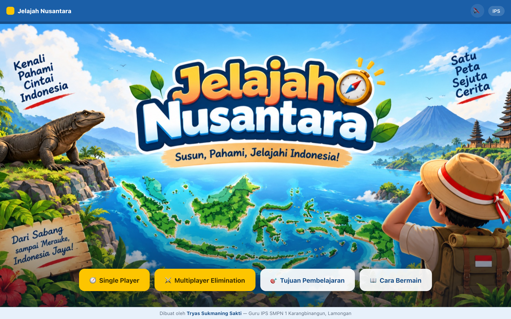

# 🧭 Jelajah Nusantara

An **interactive map game** for junior-high geography (IPS, Fase D, Grade VII). Drag each Indonesian island onto its place on the map, then take a quiz on what makes each region unique — its natural resources, climate, and landforms. A camera-based **Multiplayer Elimination** mode turns the whole classroom into a true/false game. Built for **Festival Biru Putih 2026** (Direktorat SMP, Kemendikdasmen).



> Part of the **one-day-one-code** repo — see the full catalog in [`../index.html`](../index.html).

## Play

Open `index.html` directly in a browser — fully static and offline, no install needed.

```bash
# recommended for Multiplayer mode (camera needs http://localhost or HTTPS)
python3 -m http.server 8000   # then open http://localhost:8000
```

## Features

- **🧭 Single Player** — *Build the Map*: drag island names onto the map, then a **10-question quiz** drawn at random (and balanced) from a bank of 33: Guess the Location, Multiple Choice, and True/False — with a timer and combos.
- **⚔️ Multiplayer Elimination** — students line up in front of the webcam; a statement appears and they move **LEFT = TRUE** or **RIGHT = FALSE** before time runs out. Wrong side is eliminated until one winner remains (40 statements, adjustable timer). Still playable without a camera.
- **Instant feedback** with an explanation for every answer, plus score & island badges saved to `localStorage`.
- **Editable question bank** — all questions live in `assets/soal.js` (JSON-like format), no need to touch `index.html`.
- Learning objectives & how-to-play modals, background music & sound effects (Web Audio), 16:9 responsive layout.

## Tech

Single-page `index.html` — HTML + CSS + Vanilla JS, no framework, no build step, no external URLs. Question bank in `assets/soal.js`, map & cover art in `assets/`. `panduan.html` is the user guide.

> By **Tryas Sukmaning Sakti** — IPS teacher, SMPN 1 Karangbinangun, Lamongan · Festival Biru Putih 2026
