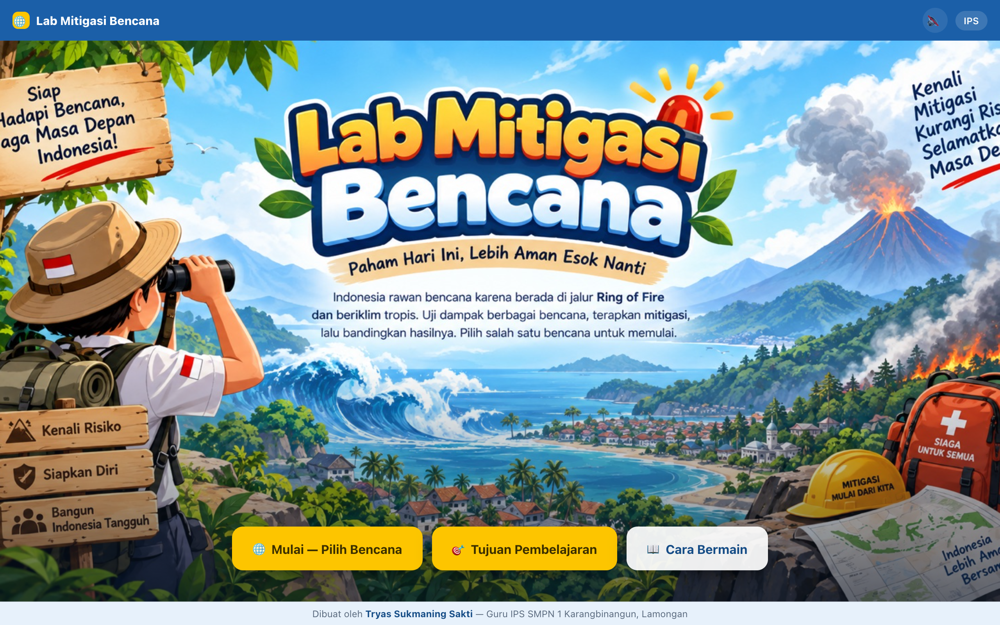

# 🌋 Lab Mitigasi Bencana

A **virtual disaster-mitigation lab** for junior-high geography (IPS, Fase D, Grade VIII). Pick a disaster — **earthquake, tsunami, volcanic eruption, flood, or wildfire** — set its intensity, watch the impact in real time, then apply mitigation measures and compare the before/after results. Ties Indonesia's position on the **Ring of Fire** to SDG 11 (sustainable cities & communities). Built for **Festival Biru Putih 2026** (Direktorat SMP, Kemendikdasmen).



> Part of the **one-day-one-code** repo — see the full catalog in [`../index.html`](../index.html).

## Play

Open `index.html` directly in a browser — fully static and offline, no install needed.

```bash
# optional, via local server
python3 -m http.server 8000   # then open http://localhost:8000
```

## Features

- **5 disaster scenarios**, each a guided **4-step experiment**: set variables → adjust intensity & run the simulation → apply mitigation → application & reflection.
- **Progress indicator** ("Step x of 4") with free navigation back to any step.
- **Before vs. after mitigation** comparison of damage and impact.
- **Application questions** per disaster with explanations — editable in `assets/soal.js`.
- Learning objectives & how-to-play modals, 16:9 responsive layout, sound on/off.

## Tech

Single-page `index.html` — HTML + CSS + Vanilla JS, no framework, no build step, no external URLs. Scene backgrounds (SVG) and photos in `assets/`. `panduan.html` is the user guide.

> By **Tryas Sukmaning Sakti** — IPS teacher, SMPN 1 Karangbinangun, Lamongan · Festival Biru Putih 2026
