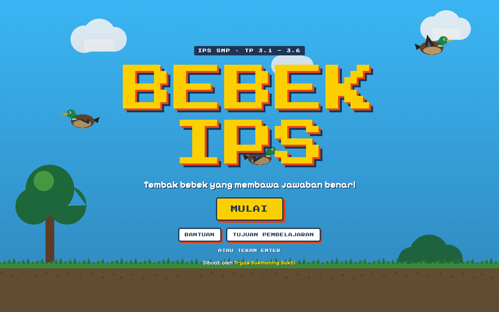

# 🦆 Bebek IPS

A **pixel-art shooting game** inspired by *Duck Hunt*, for junior-high social studies (IPS, Fase D, Grade VIII). A question appears in the panel — shoot the **duck carrying the right answer**. Three levels of increasing difficulty covering learning objectives **TP 3.1–3.6** (natural resources, markets & prices, Indonesia's development potential, social interaction). Built for **Festival Biru Putih 2026** (Direktorat SMP, Kemendikdasmen).



> Part of the **one-day-one-code** repo — see the full catalog in [`../index.html`](../index.html).

## Play

Open `index.html` directly in a browser — no install needed.

```bash
# optional, via local server
python3 -m http.server 8000   # then open http://localhost:8000
```

> Fonts (*Press Start 2P*, *Pixelify Sans*) currently load from Google Fonts; offline, the game falls back to system fonts.

## Controls & rules

- **Shoot** the right duck: click/tap it, or press **A–E**.
- **3 lives** — a wrong shot or timeout costs one life and reveals the correct answer.
- **Score**: 100 pts + 10 pts per second left, **combo bonus** +25 per streak (max +250), level multiplier ×1 / ×1.5 / ×2.
- **20 questions per game**; clear a level to **unlock** the next. High scores & unlocks are saved to `localStorage`.
- Keys: **1–3** pick level · **P / Esc** pause · **M** sound on/off · **Enter** start.

## Tech

Single-file `index.html` — HTML + CSS + Vanilla JS + **HTML5 Canvas** (pixel-art graphics), no framework, no build step. `panduan.html` is the user guide.

> By **Tryas Sukmaning Sakti** — Festival Biru Putih 2026
