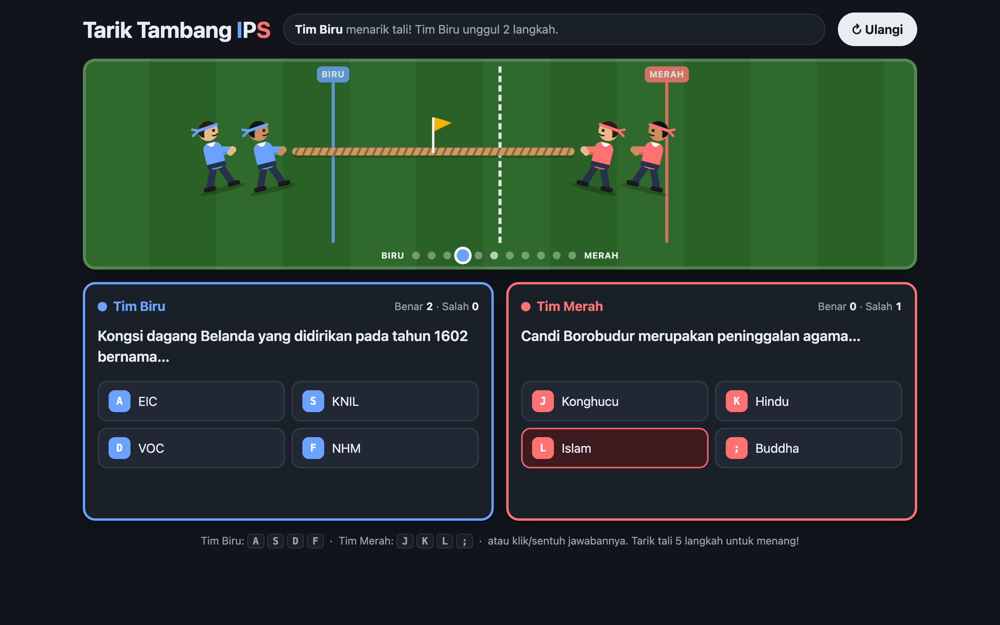

# 🪢 Tarik Tambang IPS

A **2-player tug-of-war quiz** for junior-high social studies (IPS, Grades VII–IX). Team Blue on the left and Team Red on the right answer different multiple-choice questions **at the same time** — every correct answer pulls the rope one step toward that team. First to pull the flag **5 steps** to their side wins.



> Part of the **one-day-one-code** repo — see the full catalog in [`../index.html`](../index.html).

## Play

Open `index.html` directly in a browser — fully offline, no install needed.

```bash
# optional, via local server
python3 -m http.server 8000   # then open http://localhost:8000
```

## Controls & rules

- **Team Blue**: keys **A S D F** for options 1–4. **Team Red**: keys **J K L ;**. Options can also be clicked/tapped.
- **Correct** → the button turns green, the rope moves 1 step to your side, and a new question appears.
- **Wrong** → the button turns red and your panel is **locked for 1.5 s**, then a new question appears.
- Pull the rope **5 steps** to win → winner popup with **Main lagi** (play again). **Ulangi** at the top restarts any time.
- A 3-2-1 countdown starts every round.

## Question bank

36 questions covering history, economics, geography, civics (PPKn) and sociology. Questions are drawn at random with **no repeats until the bank runs out**, the two teams always get different questions, and the option order is shuffled each time. Edit the `BANK_SOAL` array — format: `["question", "correct answer", "wrong1", "wrong2", "wrong3"]`.

## Tech

Single-file `index.html` — HTML + CSS + Vanilla JS, no framework, no library, no web fonts. The characters are inline SVG. Supports light/dark mode, `prefers-reduced-motion`, visible keyboard focus, and a responsive layout (panels stack on phones).
